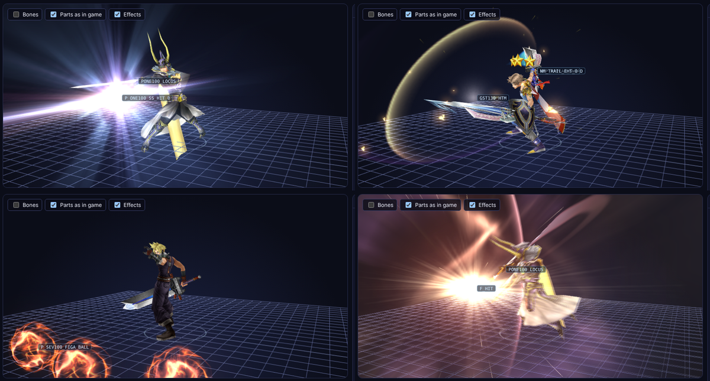
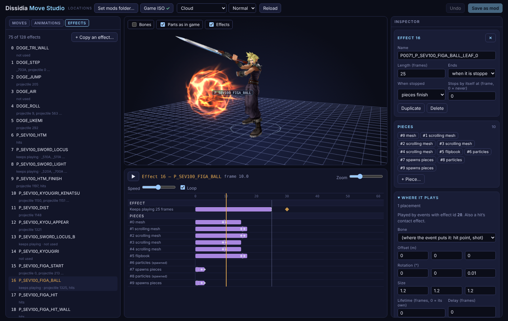

# Move Studio: reference

Every panel and switch of the Move Studio (`studio/index.html`), what the dummy simulates, the effect editor, and which file does what. The short guide is [../studio/README.md](../../../../studio/README.md).

## Retail characters
- Click **Set game ISO…** (also under Locations) and pick your Dissidia 012 ISO. The retail fighters join the character list under *From the game ISO*, with every costume and the assist as rigs. The ISO is read in place, never copied.
- Moves carry their real ability names from the game's own tables (and brave / HP, ground / midair in the tooltip). Commands with no ability record (EX Bursts and such) show as *Command 0xNN*.
- **Change one and press *Save as mod*.** That makes a folder in `mods` named after the character (`mods/cloud`, `mods/warrior-of-light`) with `"kind": "retail"` in its mod.json: both movesets (fighter and assist) unpacked like any mod, the 1P rigs, and the files they replace (`obj/p_sev100.objx` …). If the mods folder isn't open yet, Chrome asks for it.
- The studio then opens that folder: it is listed as *Cloud (Modded)*, and the ISO entry becomes *Cloud (original)*, read-only, for comparing.
- **Into the game:** build as usual (`charmod.py build cloud`, Blender *Build into the game*, or `run.sh` at launch). Only files that differ from the retail ones are installed, over the retail paths, so the game uses your Cloud everywhere. Set `"enabled": false` in its mod.json (or delete the folder) and the next build of all mods takes the files out again: retail Cloud is back.
- Setting a location never changes what you're looking at; it only adds characters to the list. A set location shows a tick.
- Chrome remembers the ISO and offers *Use … again* next time (it asks once per visit before reading it).

## Using it
- **Header:** pick the character and the rig. `_1p` is the fighter; `_a` is the assist.
- **Moves:** every move with its presses. Click a press to see its animation and its events.
- **Body** (viewport, mod characters with skins): which of the character's skins (`skins/<name>/`, its body and weapons) is on the model. It starts on the one the game build uses (`mod.json` `body.skin`, marked *in game*); *Use in game* switches the game to the one shown. It is put on exactly as `charmod.py build` does (`charmod_gmo.apply_skin`, same bytes). Making a skin is in Blender (Character mods > *Make skin*), or *Replace with my model…* below.
- **Animations:** every animation in the rig, with the moves that use it.
- **Timeline:** one row per event, grouped by category.
  - A bar runs from start to end; a diamond fires on one frame. A dashed end means "until the animation ends".
  - Drag a bar to move it, drag its ends to resize it, and click the ruler to scrub. Hold <kbd>Alt</kbd> while dragging for half frames.
  - The keys <kbd>Space</kbd> play, <kbd>←</kbd>/<kbd>→</kbd> step a frame, <kbd>Delete</kbd> removes the selected event, <kbd>Ctrl/⌘ Z</kbd> undoes and <kbd>Ctrl/⌘ S</kbd> saves.
- **Face expressions:** the 3D view plays the model's face texture groups (GMO BlindData `TexAnm`, e.g. Shantotto `0_left`, `1_right`, `2_lip`, `3_tue`) with their `default:` pattern, blinking included, and a `face_texture` event (0x0214, face_part = group id, pattern = pattern number) switches its group while the playhead is inside its range (EX Mode and phase filters apply). Each group copies a cell of its `source:` sheet into a rectangle of its `target:` texture, as the game does (FUN_0886E5D0: cell = 16 px units, frame lengths in ticks, random between two lengths for blinks). A model whose own face doesn't use the target texture (Vivi, Noctis) shows no change, as in game. Code: `studio/facetex.js`; `ftInfo()` in the console lists the groups.
- **+ Add event:** every event the game knows, searchable, with a one-line description of each (`EVENT_OPS.md` has the details). A new event is shaped like the same event elsewhere in the moveset, or like retail's.
- **Inspector:** edit the selected event.
  - Timing.
  - The hit, part (bone) or effect, picked by name. Effects come from the character's `effects.json`.
  - Its other values.
  - Its filter: phase, and EX Mode only / outside EX Mode.
  - A hit window also shows its **hit**: power, re-hit, reaction, HP attack, knock-back, stun. *Give this event its own copy* when other moves share that hit.
- **With no event selected**, the inspector shows the animation instead:
  - which moves use it;
  - **Parts hidden at start** (tick boxes);
  - the animation's checks;
  - **Duplicate this animation** (mod characters): a copy of it as a new motion of the character — the motion chunk is cloned into every model of the moveset, its timeline copied or left empty, and the selected press can be pointed at the copy (its script's motion_map row); one undo step (`dupMotion`, copy.js). For changing a shared animation for one move only.
- **A selected press** can be switched to another animation from the rig. That is how a new Blender animation gets used by a move.
- **Checks** (header badge):
  - more than 16 part show / hide ranges at once (the game keeps track of 16; the rest never run). Events whose filters can't both pass (EX Mode only and outside EX Mode, different phases) are counted separately. Other start→end events have no such limit (retail Cloud runs 17 at once), and events after the animation ends are fine (the timeline keeps running while the last frame holds);
  - hits or parts that don't exist;
  - a combo press with no chain window for the next press.
- **Save** writes only the files that changed, in exactly the format `tools/charmod_objx.py` writes. Then build the character as usual (Blender *Build into the game*, `charmod.py build`, or `run.sh` at launch).

## Moves
- **Click a move's name** (or one of its presses) for the move panel at the top of the inspector.
- **Play the whole move:** the presses one after another, as in a fight. The strip above the timeline shows each press and where the playhead is; click a press to jump to it.
  - By default the next press takes over at its chain window (the earliest the game lets it start). Pick *each animation to its end* to watch every animation in full.
- **Type: Brave / HP** and **Starts: Ground / Midair / Follow-up** are the ability's (its `ablt` record, set at build time from `mod.json` `move_names`). *Follow-up* also asks which move it follows.
  - The damage itself comes from each hit's HP flag. The panel counts the move's brave and HP hits (its hit events and the projectiles they fire, with the bullets those spawn) and warns when they don't match the type: *Make the last hit an HP hit*, or *Make its hits brave*. A hit other moves use too gets a copy of its own first.
  - When the first press's action is set to start on the other ground / air side, it offers to change that too (plya byte +5: 2 ground, 1 air).
- **Name** and **help text** (with `{ground}`, `{midair}`, `{bonus}`, `{effects}` as in `mod.json`), and **In the character's kit** (`disabled`: the record stays, the game doesn't offer it).
- **EX Burst** (last in the Moves list): the nine scripts the game starts from code, as presses: 8000 lead-in, 8101 weapons appear, 8102 draw, 8103–8106 one strike per prompt, 8500 finisher, 8600 exit. *Play the whole burst* chains them at full length; the dummy takes every hit (the prompts are played as all successful, and the foe stays hittable between hits, as the burst holds it). Each script's animation can be changed like a press's.
- **Game camera** (viewport, when the animation moves the `camera_include` bone: EX Bursts, some HP moves): look through the game's camera. The bone's position is the eye, it looks down its −Z with +Y up, and its Z scale is the field of view (shown next to the switch).
- **+ New move** (mod characters): a new ability with its own command.
  - Name, type, start, learn level, help.
  - *One press* with an animation you pick, or a copy of an existing move's presses.
  - It adds the next free ability (a `copy` of a similar move's record, so its CP cost and bonus line), the next command id, an action and script per press, their `motion_map.json` rows, and a CPU row (`brat`) like the copied move's.
  - The presses play the copy's animations, so they share its events: pick another animation for a press, and create its timeline, to give it its own.
  - Save, build, then equip it in the game's Abilities screen.
- **Copy a move from…** (in *+ New move*): a move of a retail character (game ISO) or another mod character, with everything it uses (`copy.js`):
  - the command (new id), its presses' actions and scripts (and the actions their chain windows offer), the `motion_map.json` rows and the CPU row;
  - its **animations**, added to every model of this moveset (the costume models that share it come in from the ISO, and `mod.json` `files` lists them so the build installs them). Bones are matched by name; on another skeleton a bone it doesn't have stays still and translation keys of bones of another length are dropped (refine it in Blender);
  - its timelines with the events renumbered, its hits (identical ones are shared), hitbox groups (bones by name), projectiles with their children and pool values, effects (when the package has room for them), its own sounds (appended to this bank) and its HP banner;
  - left out: show / hide events of parts this rig doesn't have, voices and face textures. The move panel lists what came and what didn't.
- **Cost and learning** (move panel): CP to equip, CP once mastered (default half), AP to master, the level it is learnt at (for every ability, not only new ones) and the equip bonus (a system.bin `fncs` effect set; the help text's `{bonus}` line describes the copied one). Empty = as the copied record (its values show as placeholders with the ISO). The build writes them into the `ablt` record (`roster_mainbin.py`; `docs/archive/ablt-fields`).
- **Dummy** (viewport): a foe that takes the move's hits, to see juggles, knock-back and hit-stun. Set how far in front it starts and how high above the floor the fight is (empty = 4 m for midair moves). It runs the whole move (all presses, as *Play the whole move* chains them) and shows, at the playhead, both fighters where the game would have them: the dummy's state (hit-stun, knocked, in the air, down), when it can act again, its path, where each hit landed, the live hit spheres (with their sweep back to last tick), projectiles in flight, and the attacker's own travel. The camera follows the two.
  - **Contact** is the game's (`docs/archive/hit-contact`): spheres only, `|b − a| < ra + rb`; the armed group's kind-4 spheres against the dummy's kind-3 then kind-2 hurt spheres; each sphere swept back toward last tick's position; a window's first tick never hits; guard / EX / block classes never hurt.
  - **Reactions** (`docs/archive/hit-reaction`): each reaction's movement, the hit-reaction gravity, 50 ticks of stun on every hit with no juggle cap, the down state after a blow-away.
  - **Projectiles** (`docs/archive/projectile-flight`, `magi.js`): spawned, flown and homed as the game does (parameter draws with the game's random generator, turn limits, gravity, speed clamps), with their swept hit sphere or upright column, `link_*` children (Alterna's chain) and pull fields.
  - **The attacker** (`docs/archive/attacker-movement`, `actor.js`): root motion (the animation's `trans_include` travel, where most attack travel is), homing dashes, ground homing lunges, lunges, slides, turning toward the foe, chase dashes, hanging in the air during air moves, falling with his own gravity after, and landing.
  - **Runtime hooks** (mod characters; `mod.json` `runtime_hooks`, as `runtime/roster.cpp` runs them in game): `warp=` / `warpreach=` home a motion's root-motion travel onto the foe (stopping STOP metres short), `vtrack=` eases a motion to the foe's height, `hitact=` starts an action when its projectile spawns (Alterna's grip → the follow-up with the big HP hit), `landact=` starts an action at touchdown (Greatsword → the slam). A started action is added to the whole-move strip (marked ↳).
  - **The dummy's body**: a second copy of the character playing the motion of its reaction script (flinch, stagger, blow-away, down, landing, guard, dodge, wall), and its hurt spheres follow that pose.
  - **What it does** when it can act and an attack starts within a few ticks (`docs/archive/guard-dodge-walls`): *takes it*, *guards* (the GUARD window over ticks 0–36; the game's clash table decides: blocked, and the attacker recoils and its move ends there, or crushed by classes 2 / 3, or through from behind), or *dodges* back, sideways, toward (a hop) or in the air (invincible 0–20, the dodge animation's own travel).
  - **A wall** N m behind it: a straight flight or a reaction-12 blow that hits it head on wall-rushes (pinned and invincible, can act from 70, then falls and lands).
  - **EX Mode** (viewport switch): events set to *EX Mode only* run and those set to *outside EX Mode* don't, for parts, effects and the dummy; EX-only parts show; events that don't run are dimmed on the timeline.
  - **Approximate:** the body push-apart (the game's resolver wasn't read: the overlap is split evenly); the recoil speed inputs and what re-arms the wall check; an origin-6 projectile starts at its effect record's bone and offset; a landing doesn't switch to the landing motion (the info box says where the game would cut the move); no hit-stop.
- Retail characters, and mods that change a retail character, show their abilities read-only (their names and types stay the retail ones).
- `mod.json` is saved by rewriting only the values that changed, so the rest of the file keeps its exact text.

## The rest of a moveset
Select an event (or a press, or an animation) and the inspector shows the data behind it. Mod characters only; retail characters show it read-only.
- **Hitboxes** (a hit window's group, objx section type 5): every sphere's kind (4 = deals the hit, 6 = clashes with attacks and guards, 5 = against projectiles, 7 = trail point), bone (or the character's root), offset in the bone's own frame and radius. *+ Add sphere*; *Give this window its own group* when other windows share it. The selected window's spheres are drawn on the model (red hits, blue clash).
- **Projectiles** (a `fire_projectile` / `hit_window_fire` event, `projectiles.json`): the hit (and the one after a reflect), hit radius or upright column, how it moves (straight, homing, parked, glued), what it homes on, where it starts and which way it points, its children (at birth or in flight, on hit, on terrain), every parameter (a value, a random range `2..4`, `+0.5` per later shot), the flags, and the runtime's *start an action when it spawns* (`hitact=`). *Copy to a new projectile* gives the event its own. Values go into the record's shared float pool (128 at most; unused values are dropped when it fills).
- **Press settings** (a selected press, `actions.json`): starts on the ground / in the air / anywhere, follow-up only, the distance and height windows the CPU needs, a homing dash when the press starts, the CPU weights (`brat`, first press), the **banner** (the name shown when an HP move lands: action byte +0x21 picks a record of the objx `text` section; its English text can be edited or a new record added, `objtext.js`), and the raw record.
- **More hit settings**: class (guard / EX / block classes never hurt), the contact effect bit, the hit sound, screen shake, the EX force byte, the knock-back bone, the clash angles.
- **Sounds** (a `sound` event, the objx `snd_` bank, `sndbank.js`): pick any of the character's slots and play it; *Import WAV…* adds a slot at the end (slots 0–123 are the base character's and stay untouched), encoded as the game's PS-ADPCM, byte-identical to `voice_bank.py` / `noc_sfx.py`. Names of imported sounds are kept in `mod.json` `sound_names`.
- **Runtime hooks** (an animation, `mod.json` `runtime_hooks`): home its travel onto the foe (`warp=`, `warpreach=`), ease to the foe's height (`vtrack=`), start an action at touchdown (`landact=`). The dummy runs them as the native build does.
- **Shared sounds** (a `sound` event whose cue isn't in the character's bank, `sharedsnd.js`, `docs/archive/shared-sounds`): which bank and slot it is and whether battle loads it, *▶ Play* (from the ISO), and a picker of the common battle sounds (`snd_battle`, bank 1000; cue 100010 is its slot 10) and system sounds (`snd_common`).
- **Copy and paste events:** Ctrl+C copies the selected event, or with nothing selected all of the animation's events (not its parts hidden at the start); Ctrl+V pastes at the playhead (Shift keeps their times), into any animation of any character. Hits, parts or projectiles the other character doesn't have show up in the checks.

## Checks and changes
- **Checks** (the problems badge): too many part show / hide ranges at once, unknown hits / parts / events, events after the animation ends, presses with no chain window; projectile ids that aren't in `projectiles.json` (events and `link_*` children), projectile hits and effects that don't exist, hitbox groups with no spheres or no attack sphere, the float pool near or over 128 values, a full effect package (128), ability keys above FF and more than 150 abilities.
- **Recomp only** (notes in the checks; a *recomp* tag on moves; the move panel and Character tab say why): an extra character (a new roster slot) and the runtime hooks (`warp=`, `landact=`, `hitact=`, `dash=` …) work only with the recomp's runtime. A stock game (PSP, PPSSPP, a patched ISO) can't add characters, and plays a hooked move as its plain animation and events. Notes don't count as problems.
- **Changes** (click *N files changed*): what saving would write and the next build would pack, file by file: abilities, commands, actions, motion rows, hits, projectiles, timeline events added / removed, hitbox spheres, CPU rows, sound slots, banners, animations.

## Characters
- **+ New character…** (character picker, with the game ISO and a mods folder): name, full name, series, the retail character it is built on, its code (from the name) and a picture. It makes the folder `charmod.py new` would: `mod.json`, the built-on moveset unpacked in `moveset/`, its battle costume models in `models/`, and the menu pictures to be cut from the picture at the first build (a grey silhouette until you set one). Start the game (or `charmod.py build <name>`) to add it to the roster.
- **Character tab** (left, mod characters):
  - **Name, series, roster:** name, full name, series, roster slot.
  - **Costumes:** the game's three other costume slots (Costume 2, Costume 3, Manikin). Until you add one, a slot shows the main model (`mod.json` points its paths at the 1P files; a new character starts that way, and replacing the main body resets them). *Add…* copies the main model files to `models/p_<code>_<slot>.gmo` (and the assist), saves, and has Blender fit your model into them (the body is baked into the costume's files, which stay out of `body.models`); cancelling undoes it. *Replace model…* fits another; *Remove* points the slot back at the main model and Save deletes its files.
  - **Body:** the skins, as above, and **Replace with my model…**: Blender (open, with the add-on 0.25+) opens the character, asks for a model file (FBX, glTF/GLB, VRM, OBJ or .blend) and fits it onto the character's skeleton (below); the result comes back as a new skin, shown on the model and set for the game (`body.skin`, `body.models`), on every model of the character. The costumes become that one model (2P, 3P, zako and their assists point at the first one's files); Save removes the based-on character's costume models from `models/`. The Studio follows Blender's progress. Save, then build.
  - **Jump, gravity, dash:** the built-on character's spec record (jump height and time, rise and fall gravity, terminal fall, air drift; read only) and the dash speed (`dash=` runtime hook).
  - **Jump, gravity, dash:** the 3D view alone (no timeline) previews them on a loop: the character's own jump (script 100), fall (101) and landing (102) animations moved by the spec record (rise to the jump height in T ticks, fall at gravity × P60 down to the terminal speed), a ring at the jump height, then the dash (script 240: 24 ticks of start-up, then forward at Bartz's start speed 0.6 m/tick × the dash= factor for 36 ticks; the game's slow-down over the dash isn't modelled) with the camera following. Jump and dash, Jump or Dash alone, and slow motion are in the inspector.
  - **Roster slot:** a list of the free slots 33–42 (33 and 34 are retail slots the game leaves unused); a slot another character in the mods folder also has is flagged.
  - **Menu art:** one screen in place of the 3D view and timeline. The art (`generated_from.picture`) with a box per cut picture (slide-in, grid tile, HUD portrait, VS face, face strip): drag a box, drag its corner to resize. Beside it every menu and HUD picture as a card: what it is now (*Cut from the art*, *Placed by the build* when it has no box, *Drawn from the name*, *Your picture*, *The built-on one's*) and a preview (the live cut, the built PNG, or the built-on character's picture from the ISO). Click a card to show only its box and its details in the inspector; *Set a box* gives a placed-by-the-build picture a box; *Use mine…* (or drop an image on the card) sets a picture of your own, scaled to the avatar's size and written to `avatars/own/<key>.png` with `_own`, so the cut one stays to go back to. Tile cut-out, Mirror HUD, *Custom art…* and *Reset boxes* are in the bar. The build cuts the pictures again whenever the art, a box or an option changes.

## Effects

- The **Effects** switch in the 3D view (on by default) plays the effects the animation's events start, with each effect's name at the spot it plays from.
- **It draws them the way the game does.** The renderer is a re-implementation of the game's own effect code, read from the recompiled EBOOT ([how the game draws effects](effects.md)):
  - **Placement and timing:** the effect record's bone, offset, rotation and scale, its attach rules (follow the bone, spawn once, take the root's rotation or position), start delay and lifetime; effects that keep playing until they are stopped, their loops, and how they fade out or play out when stopped.
  - **Pieces:** meshes with their own materials and texture cells, flipbooks (every part of the current clip), meshes with scrolling textures, camera-facing and axis-locked pieces, and the game's colour, blend and depth rules.
  - **Particles:** the game's emitter, replayed from the start of the piece (spawn shapes, speed, forces, size, spin, colour, fade, world or local space).
  - **Weapon trails:** the blade's last 4–15 positions, tapered, coloured and textured, smoothed with the same B-spline the PSP draws.
  - **Screen effects:** the hit flash, the zoom blur, the shockwave ring and the screen shift of channel 111 (redrawn from a copy of the frame).
  - **Line and point emitters** (`docs/archive/fx-components/G.md`): spark streaks (100), lines that converge on the centre (102), box rays (103) and points bouncing in a box (95), with the game's emission, life and fade.
  - **Weapon glows:** *Bone effect* 8888 plays like the 9999 trails (one effect per slot while its ranges run).
  - **Not exact:** the game draws its random numbers from one shared sequence, so the preview's random spread differs from any one play; the shockwave ring is a close approximation; channels 82 and 58 (one piece each in the game) aren't drawn; projectiles fly straight ahead at their speed (no homing); a hit's contact effect is drawn where the foe would be, 1.6 m in front.
- **Where effects come from:** effect events, timed effects, weapon trails and glows (*Bone effect* 9999 / 8888), projectiles (*Fire projectile* → the shot's visual), hits (the hit's contact-effect bit) and the animation itself (records bound to its motion name start with it, as in the game: Vaan's spell circles).
- **On the timeline**, an effect event shows a thin bar for how long the effect plays.
- **In the inspector**, an effect event also shows its effect: length, bone, what it's made of, and its textures.
- **Shared pieces:** about 40% of the pieces come from the game's shared effect library, so set the game ISO (Locations) to see them, for mod characters too.

## Spawned objects

- The **Objects** switch in the 3D view (on by default; needs the game ISO) draws what a move's `hold_prop` (0x075A) and `summon_object` (0x0C65) events spawn: Gilgamesh's swords, Yuna's aeons, Bartz's mimicked weapons. The game's table and the object files are on the disc only ([spawned-objects.md](spawned-objects.md)).
- **Which object:** the event's wpnp row → its objentry record → `obj/<stem>.objx` + `.gmo`; the row's script is the motion the object plays (from the event's start, plus `hold_prop`'s start time). The inspector names it under the event (*wpnp row 48: w_ten111 · script 10040, on bone 55 (summon1), then left in place*).
- **Where:** on the owner's bone the event's id names (Gilgamesh 37 / 61 = his hands, Yuna 55 / 56 = `summon1` / `summon2`), with `summon_object`'s x, y, z offset, on the owner's root, or on another object. With *let go* (arg 3) it stays where it appeared and moves by its own animation; with the dummy on, where the travelling owner was then.
- **Across presses:** an object the previous press left out (same id, same object, its range running to the press's end) stays: same place, and with the same row its motion carries on (Ifrit through Meteor Strike).
- **Fades:** the event's fade-in / fade-out, `prop_fade` (0x0360), the object's own `fade_self_in` and part shows / hides.
- **Effects:** the row's spawn effect (Gilgamesh's `FIV211_WEP`), the object's own effect events (its bank), `summon_effect` (0x0335: the owner's effect on the object's bone, the aeons' summon circles), and `prop_effect` (0x055F: the trail from the prop's bank on the prop, instead of on the owner).
- **Not shown:** Gilgamesh's weapon roll (the row the event names is drawn), events with mode bytes the Studio doesn't know (`pad` 0x400), the objects' hits, projectiles and sounds, and objects spawned by overlay code (Gilgamesh's EX Mode weapons). Mod characters' copied rows (`objs=`) are past the retail table and don't show.

## Effects made of layers

**+ New effect** (Effects tab, mod characters) makes an effect the way a player sees it: layers timed together on one frame of one animation. The game has no such thing, so the layers are stored as it wants them: each layer is one effect of the package (named `P0051_<EFFECT>_<LAYER>_LEAF_0`) with one placement (bone, offset, turn, size), and **Build** writes one Effect event per layer into the animation's timeline (the frame plus the layer's start, its length as the event's lifetime), tagged `"_comp": "<file>"`. Building again replaces exactly those events. The effect itself is `mods/<character>/effects/<name>.json` (`name`, `plays: {motion, frame}`, `layers: [{name, part, id, start, life, hidden?, shader?}]`, frames at 30/s).

- **+ Layer:** a template part (the simplest retail effect of a kind: flipbook, mesh, sparks, ring, flash, trail …), a copy of any character's effect with its textures, or a shader layer.
- **Timeline:** the animation, the effect's start (drag the orange mark) and one bar per layer (drag to move, drag the end for its length). Play or scrub: the preview plays the layers with the animation, on the character.
- **A layer:** its start and length, the bone and offset, turn and size of its placement, *Placed once*, Hide, Duplicate, Delete (deletes its part), and **Edit how it looks ›**, which opens its part in the effect editor below.
- **Shader layers** (native build only, [FX_SHADERS.md](../../../FX_SHADERS.md)): *+ Layer* offers starting shaders (glow orb, glowing rim, dissolve, flowing energy, blank), and *Give it a shader…* turns any layer into one. The inspector holds the GLSL (`vec4 fx_shade()`, with the runtime's preamble: `fx_tint()`, `fx_env()`, `fx_rim()`, `u_fx_progress` …), its blend and depth, its values (uniforms: a number, 2–4 numbers or `#rrggbb`) and extra textures (*Add a PNG…*). The preview runs the shader (WebGL 2) on the same draws the game will, and shows compile errors with their line. The runtime finds a layer's draws by texture id, so each shader layer gets textures of its own: its part's textures are copied with one invisible texel changed (*New texture ids* does it again). Without the ISO, the game's shared textures and flipbooks can't be copied, so a soft white glow stands in for them. **Build** also writes `mods/<character>/files/fx_shaders/<effect>/<layer>.frag` and one `fx_shaders` draw per layer in mod.json (`name` `<effect>/<layer>`, the ids, blend, depth, `life_ticks` = the layer's length, uniforms, textures), which `charmod.py build` merges into the game's manifest. The PSP build, and the native build with shaders off, draw the part's own look.

## Editing effects
- **Remove unused…** (Effects tab): removes the effects nothing plays: no event, projectile, hit contact bit, runtime hook or unnamed event value points at their placements, they aren't bound to one of the model's animations (EX Burst effects are), and they aren't ids the engine looks up (dodges, trig records, 8888 / 9999 …). It asks first about those that came with the based-on character, then separately about your own (often earlier versions). Undo brings them back.
- **+ New…** (Effects tab): a new effect from a template, the simplest retail effect of the kind you pick (a flipbook, a mesh, a scrolling mesh, particles, spark streaks, line sparks, light rays, points, a screen flash, a shockwave, a zoom blur, a weapon trail), from this character or, with the ISO, the retail ones, copied with its textures under the name you give. Then swap its picture (*Flipbook from an image* under Textures), recolour and retime it.
- **Effects focus:** in the Effects tab the viewport is an effect editor: the character, the dummy, bones and hitboxes are hidden and the character-only switches go; *Show character* brings the character back. Opening an effect points the camera at its bone from about 5 m; leaving the tab puts the camera back where it was.
- **Key curves:** under a value track's keys (position, rotation, size, colour), its curve over the piece's life, one line per component, keys dashed; click it to move the playhead.

- **Effects tab** (left pane): every effect in the character's package, with what plays it (animations, projectiles, hits, the game itself). Click one to edit it. For a mod character (with the game ISO set) each effect is tagged by where it came from: a retail character's effect exactly as in the game, one changed from it, or new. A package holds at most 128 effects; Noctis's is full, so delete an unused one before adding.
- **While an effect is open** it plays by itself in the 3D view: on its bone, or in front of the character for hits and shots. The timeline shows the effect and its pieces. Drag a piece to change when it starts, drag its end for its life, scrub or press ▶. For effects that keep playing until stopped, the orange marker is where the preview stops them.
- **Inspector:**
  - **Effect:** name, length, whether it ends by itself or when stopped, and what stopping does. Duplicate, delete.
  - **Pieces:** pick one to edit. *+ Piece…* copies a piece from any effect of this or another character (its meshes, flipbooks and textures come with it). Duplicate, delete, or hide a piece in the preview.
  - **A piece:**
    - start, life and loop;
    - every key of its position, rotation, size and colour (+ Key at the playhead continues the curve from there; a track can go from steady to a rate to speeding up);
    - its facing; its flipbook or mesh;
    - particle settings (emission, shape, motion, size, spin, colour, fade, look);
    - trail settings (colours, blade points, length, texture, blend).
    - Position and rotation are shown with Y up, as in the game.
  - **Where it plays:** each placement (event id, bone, offset, rotation, size, lifetime, delay, follow rules). *+ Placement* gives the effect a new event id.
  - **Textures:** replace one with an image (PNG, JPG…; it is fitted to the texture's size and 256 colours), save one as PNG, or make a flipbook from an image (a grid of frames). Replacing a shared-library texture gives this effect its own copy.
- **+ Copy an effect…** copies a whole effect from this or another character (retail characters need the game ISO) with everything it uses, and gives it a placement with a new event id: play it with an *Effect* event.
- **Undo** and **Save** work as for events. Save writes the effect package (`moveset/<rig>/sections/*_effe_*.bin`); for a retail character, *Save as mod* puts it in the mod.
- **How it's written:** `fxedit.js` is a port of `blender/io_scene_dissidia/dfx/fep.py`'s block graph: an unchanged package is written back byte for byte, and an edited one keeps every pointer, table and count consistent. Edited packages were checked by reading them back with `fep.py`.

## Animations come from Blender
1. Make or retarget the animation in Blender: Character Selector → *Import from mod folder*.
2. Press *Save moves to folder*. This writes the animations into the rig. Events and hits stay as the studio left them, unless you edited events in Blender. If you did while the folder also changed, Blender refuses rather than overwrite.
3. A new animation gets an empty timeline (Blender's *New animation (from…)* gives it a copy of the source's events instead).
4. In the studio press **Reload**. Pick a press and point it at the new animation, then add its events.

## Files
- **`index.html`, `app.js`:** the studio.
- **`skins.js`:** a mod character's skins on the model (a port of `charmod_gmo.apply_skin` over the GMO chunk tree).
- **`spawn.js`:** spawned objects (`hold_prop` / `summon_object`): the wpnp and objentry tables from main.bin, each object's model, motion, placement, fades and effects ([spawned-objects.md](spawned-objects.md)).
- **`dummy.js`, `magi.js`, `actor.js`:** the dummy foe and the simulation behind it (hit volumes from objx section type 5; hit reactions and contact; projectile flight; the attacker's movement).
- **`editors.js`, `sndbank.js`, `objtext.js`:** the hitbox, projectile, press, hit, sound, banner and runtime-hook editors; the sound bank and text section codecs (`work/studio_snd`, `work/studio_text` hold their tests).
- **`burst.js`:** the EX Burst entry and the game camera.
- **`moves.js`:** the move panel (brave / HP, start, name, help, cost and learning), new moves and whole-move playback.
- **`copy.js`:** copying a move from another character (and the model edits it makes).
- **`checks.js`, `clip.js`:** the extra checks and the Changes panel; event copy / paste and the EX Mode switch.
- **`newchar.js`:** new characters and the Character tab (who, physics, menu art).
- **`fxextra.js`:** effect templates and key curves.
- **`sharedsnd.js`, `soundshare.js`:** the disc's sound bank table and shared-sound playback (from `work/studio_sharedsnd`).
- **`retail.js`:** the ISO reader (PACKAGE.BIN by path hash, from the old Forge Studio), a port of `charmod_objx.unpack` (same JSON as a mod folder; checked identical on Cloud, Bartz, Yuna and Shantotto) and the ability names (`roster_mainbin.py`'s 'ablt' records and `ability.bin`). Projectiles aren't decoded for retail characters (the section is kept as it is). A folder it writes packs back to the exact retail bytes (checked on all 31 fighters and 4 assists).
- **`fxedit.js`, `fxui.js`:** the effect editor (the package's block graph and edit operations; the Effects tab, timeline and inspector).
- **`fx.js`:** the effect renderer: the effect package (FEP / FEPA, as in `blender/io_scene_dissidia/dfx/fep.py`), the shared library (main.bin `resident.frr`), projectiles (`magi`), and the game's effect components (`docs/archive/fx-components/A.md`–`F.md`).
- **`gmo.js`:** the model reader and 3D character, from the old Forge Studio.
- **`ops.js`:** the event catalogue, generated by `tools/studio_ops.py` from `charmod_objx.NAMED` and `tools/studio_op_shapes.json` (the most common shape of each event across the 30 retail fighters). Re-run it after naming new events.
- **`images/`:** the screenshots in this README.
- **`vendor/`:** three.js r128 (MIT), so it works offline.
