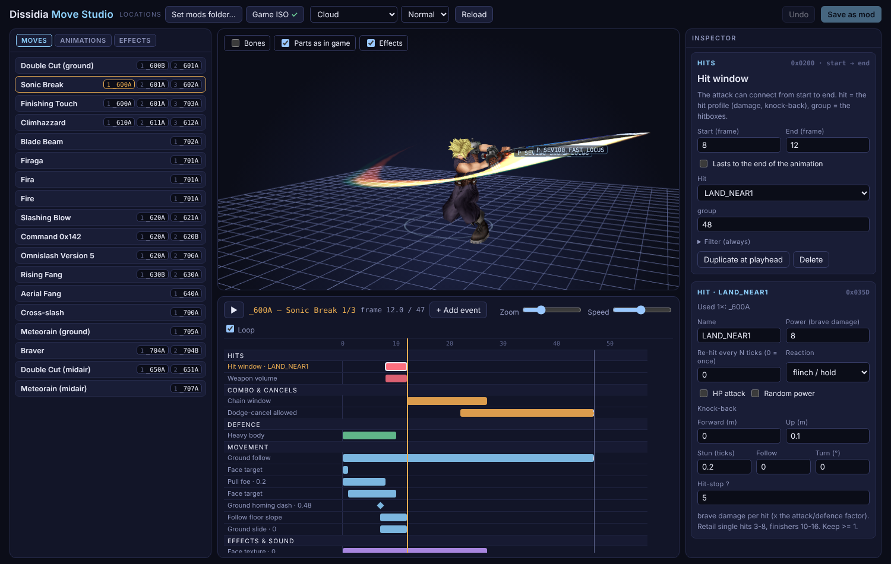

# Move Studio

Put a move together in one place: watch the character play the animation, place the move's events on a timeline, set each hit's damage and knock-back, edit the effects. It works straight on the character mod folders (`mods/<name>/`) and saves back into them.

## Opening it

1. Open `studio/index.html` in **Chrome** (or Edge). Other browsers can read but not save; Save downloads the changed files instead.
2. Top bar > **Locations > Set mods folder…** and pick the repo's `mods` folder. Chrome asks once whether the page may edit it.
3. Optional: **Set game ISO…** adds the retail cast to the character list, read-only, for looking at and copying from. Change one and press *Save as mod* to get an editable copy in `mods/`.

## Using it

- **Header:** pick the character and the rig (`_1p` is the fighter, `_a` the assist).
- **Moves:** every move with its presses. Click a press to see its animation and events. Click the move's name for its name, help text, type (Brave / HP), cost and the whole-move player.
- **Timeline:** one row per event. Drag a bar to move it, drag its ends to resize, click the ruler to scrub. <kbd>Space</kbd> plays, <kbd>←</kbd>/<kbd>→</kbd> step, <kbd>Delete</kbd> removes, <kbd>Ctrl/⌘ Z</kbd> undoes, <kbd>Ctrl/⌘ S</kbd> saves.
- **+ Add event:** every event the game knows, searchable, with a one-line description.
- **Inspector:** the selected event's timing and values. A hit window also shows its hit: power, re-hit, reaction, knock-back, stun. With nothing selected it shows the animation and which parts start hidden.
- **Objects** (viewport): what a move spawns, with its own model, motion and effects: Gilgamesh's swords, Yuna's aeons (needs the game ISO).
- **Dummy** (viewport): a foe that takes the hits, so you can see juggles, knock-back and hit-stun the way the game does them.
- **Effects** tab: **+ New effect** makes an effect out of layers (template parts, copies of any game effect, shaders), timed together on one frame of a move and previewed on the character; **Build** writes their events into the animation. Below it, *Parts* lists every effect the package stores (the layers among them): open one to edit how it looks; the viewport then frames that part alone (tick *Show character* to bring the character back).
- **+ New move** and **Copy a move from…** (any retail or mod character, with its animations, hits, projectiles, effects and sounds).
- **+ New character…** in the character picker; the **Character** tab sets the name, series, slot and the menu art (one screen: the crop boxes on your art and every menu picture, each cut, drawn or your own), and the **Body**: pick a skin, or *Replace with my model…* to have Blender fit your own model (FBX, glTF, VRM, OBJ, .blend) onto the character's skeleton.
- The **checks** badge lists problems (hits or parts that don't exist, a press with no chain window, too many parts shown at once...). Things marked *recomp* only work in the native build, not on a PSP or in PPSSPP.

**Save** writes only the files that changed. Then start the game (or `charmod.py build <name>`).

## Animations come from Blender

Make or retarget the animation in Blender ([add-on](../blender/README.md)), press *Save moves to folder*, then press **Reload** here, pick a press and point it at the new animation, and add its events.

**Duplicate this animation** (the animation's inspector, mod characters) adds a copy of the current animation as a new motion of the character, with a copy of its events, and can point the selected press at the copy straight away. Use it when a press shares its animation with other moves and you want to change it for this move only; then *Open in Blender* to change the poses.

**Open in Blender** (the animation's inspector, mod characters) shows that animation in Blender at the current frame: Blender has to be open with the add-on (0.24 or later), and imports the character's rig from its mods folder the first time. Blender and the Studio must use the same mods folder.

## Everything else

Every panel and switch, what the dummy simulates and how exact it is, the effect editor, and which file does what: [docs/move-studio.md](../psprecomp/games/dissidia/docs/move-studio.md). What every event does in the game: [docs/moves-and-events.md](../psprecomp/games/dissidia/docs/moves-and-events.md).
