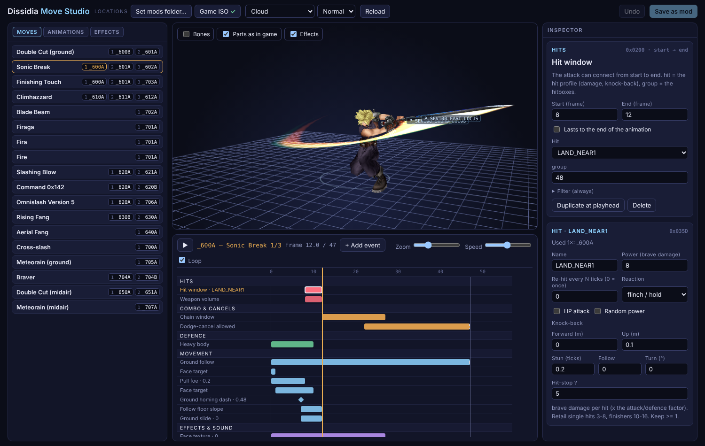

# Move Studio

Put a move together in one place: watch the character play the animation, place the move's events on a timeline, set each hit's damage and knock-back, edit the effects. It works straight on the character mod folders (`mods/<name>/`) and saves back into them.

## Opening it

1. Open `studio/index.html` in **Chrome** (or Edge). Other browsers can read but not save; Save downloads the changed files instead.
   Chrome from Flatpak (the Steam Deck's Discover store) can't see `~/dissidia` and loads a blank page. Give it that folder once, in Konsole, then restart Chrome: `flatpak override --user --filesystem=~/dissidia com.google.Chrome`. Install Blender from Flatpak and it needs the same: `flatpak override --user --filesystem=~/dissidia org.blender.Blender`.
2. Top bar > **Locations > Set mods folder…** and pick the repo's `mods` folder. Chrome asks once whether the page may edit it.
3. Optional: **Set game ISO…** adds the retail cast to the character list, read-only, for looking at and copying from. Change one and press *Save as mod* to get an editable copy in `mods/`.

## Using it

- **Header:** pick the character and the rig (`_1p` is the fighter, `_a` the assist).
- **Moves:** every move with its presses. Click a press to see its animation and events. Click the move's name for its name, help text, type (Brave / HP), cost and the whole-move player.
- **Timeline:** one row per event. Drag a bar to move it, drag its ends to resize, click the ruler to scrub. <kbd>Space</kbd> plays, <kbd>←</kbd>/<kbd>→</kbd> step, <kbd>Delete</kbd> removes, <kbd>Ctrl/⌘ Z</kbd> undoes, <kbd>Ctrl/⌘ Shift Z</kbd> or <kbd>Ctrl/⌘ Y</kbd> redoes, <kbd>Ctrl/⌘ S</kbd> saves. From the keyboard: <kbd>Tab</kbd> to the lane labels, <kbd>↑</kbd>/<kbd>↓</kbd> go from row to row, <kbd>Alt</kbd>+<kbd>←</kbd>/<kbd>→</kbd> nudges the selected event half a frame, <kbd>Shift</kbd>+<kbd>Alt</kbd>+<kbd>←</kbd>/<kbd>→</kbd> moves its end. The rows icon in the timeline bar makes the rows taller for a touchscreen.
- **Projectile lanes:** under a Fire projectile event, read-only lanes show what the shot does: its life (one bar per shot), what it spawns at launch, in flight or when it ends (a diamond, then the child's own life), and what it can spawn on a foe, a wall or floor (a hatched band over when it could happen). Click a lane to edit that projectile in the Inspector.
- **+ Add event:** every event the game knows, searchable, with a one-line description.
- **Inspector:** the selected event's timing and values. A hit window also shows its hit: power, re-hit, reaction, knock-back, stun. With nothing selected it shows the animation (Open in Blender; the rest under *Details*), its Travel, Timing and Game camera, *Show / hide parts* (the parts drawn when it starts) and its runtime hooks, one switch per hook.
- **Move inspector** (click a move's name): the preview switches on top (when the next chain attack takes over, the charge level), then Type (attack, starts on), Details (name, help text, cost), the Ability Builder (its chain attacks; *+ Add chain attack*), the Danger zone (*Enabled*, *Delete this move*) and Metadata (ids, where it was copied from).
- **Viewport camera** (as in Blender): drag with the left or middle button to orbit, hold <kbd>Shift</kbd> while dragging to pan, scroll or <kbd>Ctrl</kbd>+middle-drag to zoom; right-drag also pans.
- **Objects** (viewport): what a move spawns, with its own model, motion and effects: Gilgamesh's swords, Yuna's aeons (needs the game ISO).
- **Dummy** (viewport): a foe that takes the hits, so you can see juggles, knock-back and hit-stun the way the game does them.
- **Effects** tab: **+ New effect** makes an effect out of layers (template parts, copies of any game effect, shaders), timed together on one frame of a move and previewed on the character; **Build** writes their events into the animation. Below it, *Parts* lists every effect the package stores (the layers among them): open one to edit how it looks; the viewport then frames that part alone (tick *Show character* to bring the character back).
- **+ New move**: *New move* builds the chain of attacks with the Ability Builder; *Duplicate existing move* copies one of this character's moves, or any retail or mod character's (with its animations, hits, projectiles, effects and sounds).
- **+ New character…** in the character picker; the **Character** tab sets the name, series, slot and the menu art (one screen: the crop boxes on your art and every menu picture, each cut, drawn or your own), and the **Body**: pick a skin, or *Replace with my model…* to have Blender fit your own model (FBX, glTF, VRM, OBJ, .blend) onto the character's skeleton.
- **Alerts**, at the top of the inspector, lists the problems in what you're looking at (hits or parts that don't exist, a press with no chain window, too many parts shown at once...), with *Select it* for each and *Show all* for the whole character. Things marked *recomp* only work in the native build, not on a PSP or in PPSSPP.

**Save** writes only the files that changed. Then start the game (or `charmod.py build <name>`).

## Animations come from Blender

Make or retarget the animation in Blender ([add-on](../blender/README.md)), press *Save moves to folder*, then press **Reload** here, pick a press and point it at the new animation, and add its events.

**Travel** (the animation's inspector, and an Air motion, Ground follow or Landing allowed event's) is the movement baked into the animation: its root motion (the `trans_include` bone). Air motion only lets him leave the floor; how high he goes is this. The fields show the animation's own values as placeholders; type a **Height** or **Distance** (and a range of frames) and Apply: the travel in the range is scaled (height and forward separately) and the frames after it follow on. Scaling a whole climb-and-drop keeps the frame where he lands. The warp ghost stays where he left it; hits that hold the foe at a height from him (stagger Up) don't change with it.

**Timing** (the animation's inspector) plays part of an animation faster or slower: pick **From** / **To** frames and a new **Length** (or a **Speed** in %) and Apply. Every key in the range moves in time, so the poses keep their exact shape (keys are added at the range's ends where it cuts between two); frames after it move with its end, and so do the frame range's loop start and end (0x80B1 is {loop start, end}: an animation plays from frame 0 and loops back to the loop start, e.g. a victory's idle tail). The events on its timeline move with the frames they sit on (rounded to whole ticks). Runtime hooks keep their own numbers: the result names any on that animation to check.

**Game camera** (the animation's inspector) keys the camera the game films the animation through: the `camera_include` bone (position = eye, looking down its −Z, Z scale = field of view in degrees). Retail keys it in EX Bursts and some entries and victories (Vaan `_900A`, Shantotto `_910A`). Frame the shot in the viewport, set the field of view and **Key the view**; *Cut to this shot* jumps instead of moving from the previous key. Tick **Game camera** above the viewport to watch it. **Clear** puts the bone back at rest, which means "the game's own camera". Keys are linear (rotation slerp), full floats; where the exporter bound the camera to a curve shared with other bones it gets curves of its own.

**Hits** (View) puts a tag on every hit: with the Dummy on, where each one landed on the dummy (`press · hit`, the other presses' hits dimmed); without it, the hit windows live at the playhead, on their attack spheres. Click a tag to go to that hit: the press, the playhead and its event in the timeline and the Inspector.

**Duplicate this animation** (the animation's inspector, mod characters) adds a copy of the current animation as a new motion of the character, with a copy of its events, and can point the selected press at the copy straight away. Use it when a press shares its animation with other moves and you want to change it for this move only; then *Open in Blender* to change the poses.

**Open in Blender** (the animation's inspector, mod characters) shows that animation in Blender at the current frame: Blender has to be open with the add-on (0.24 or later), and imports the character's rig from its mods folder the first time. Blender and the Studio must use the same mods folder.

## Everything else

Every panel and switch, what the dummy simulates and how exact it is, the effect editor, and which file does what: [docs/move-studio.md](../psprecomp/games/dissidia/docs/move-studio.md). What every event does in the game: [docs/moves-and-events.md](../psprecomp/games/dissidia/docs/moves-and-events.md).
